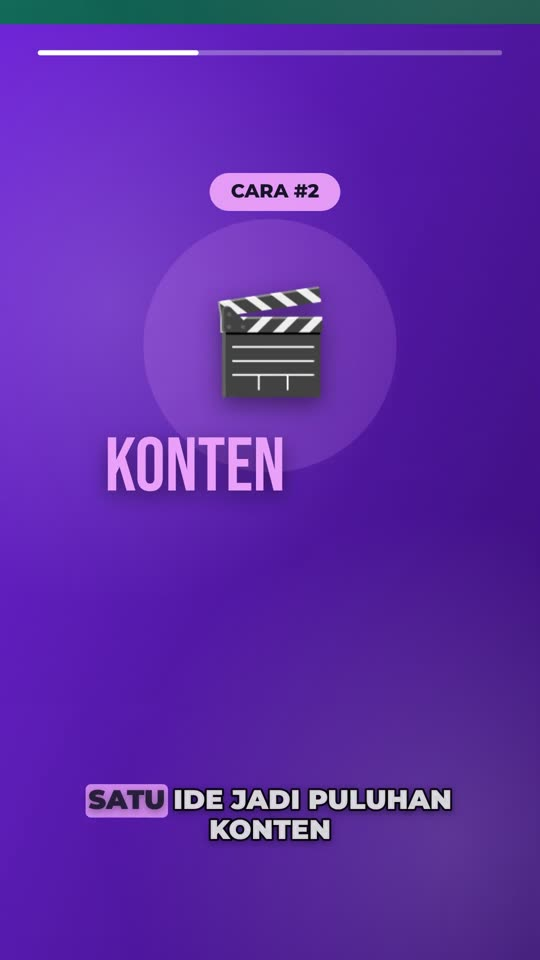

# KanvasCut — editor video HTML Canvas + AI

Editor video mirip CapCut yang berjalan 100% di browser: preview dan render memakai
**HTML Canvas**, ekspor memakai **WebCodecs → MP4 H.264** (tanpa server, tanpa biaya render), dan
fitur AI memakai **Claude API** langsung dari browser.

> **Juga di repo ini:** [`datasains/`](datasains/) — toolkit data science (EDA → AutoML → submission) untuk laptop dan Kaggle.

## Contoh hasil

Video 9:16 tema "Bisnis dengan AI", dirender oleh editor ini dari template bawaan (tab **Template**),
lengkap dengan narasi dan subtitle karaoke yang sinkron:

- [`examples/bisnis-ai-wanita.mp4`](examples/bisnis-ai-wanita.mp4) — narasi Ava (wanita, ekspresif)
- [`examples/bisnis-ai-pria.mp4`](examples/bisnis-ai-pria.mp4) — narasi Andrew (pria, ekspresif)
- [`examples/cuanki-buhaji.mp4`](examples/cuanki-buhaji.mp4) — video promosi Cuanki Buhaji Factory (foto asli, narasi Ava),
  dari template **Cuanki Buhaji Factory**
- [`examples/contoh-6-suara.mp3`](examples/contoh-6-suara.mp3) — perbandingan suara: Ava, Emma, Gadis, Andrew, Brian, Ardi

Narasi ada di `examples/assets/suara/` (dibuat dengan `buat_suara.py`); musik latar disintesis
sendiri (`examples/assets/musik-bisnis.mp3`), jadi bebas hak cipta.



## Membuka aplikasi

**Online gratis lewat GitHub Pages (disarankan):**

1. Buka repo di GitHub → **Settings** → **Pages**.
2. *Source*: **Deploy from a branch**. Pilih branch yang berisi kode ini dan folder **/ (root)**, lalu **Save**.
3. Tunggu 1–2 menit, aplikasi terbuka di `https://<username>.github.io/<nama-repo>/`
   (bisa dibuka di laptop maupun HP, pakai Chrome/Edge terbaru).

**Di komputer sendiri:** tidak perlu build, cukup sajikan foldernya lewat HTTP
(ES module tidak jalan kalau file dibuka langsung dari `file://`):

```bash
python serve.py
# buka http://localhost:8000 — server ini mematikan cache, jadi update selalu langsung terlihat
```

Untuk memperbarui ke versi terbaru: `git pull`, jalankan ulang `python serve.py`, lalu cek nomor versi
di samping logo KanvasCut.

## Fitur

- Impor video, gambar, audio (klik atau drag & drop)
- Timeline multi-track: geser klip, trim ujung kiri/kanan, snap ke playhead & tepi klip, zoom
- Potong (S), duplikat (Ctrl+D), hapus (Del), undo/redo (Ctrl+Z / Ctrl+Shift+Z)
- Teks dengan preset (judul, subtitle, caption kotak, neon, lower third), font, warna,
  garis tepi, glow, latar, animasi (pop, fade, slide, mesin ketik)
- Transformasi langsung di preview (geser, scroll untuk skala), rotasi, opasitas, fade in/out
- Filter: kecerahan, kontras, saturasi, grayscale, hue, blur
- Kecepatan klip 0.25x–4x, volume, mute
- Rasio 9:16, 16:9, 1:1, 4:5
- **Transisi** antar klip: crossfade, geser, zoom, whip (blur cepat), wipe, lingkaran
- **Keyframe** posisi/skala/rotasi/opasitas dengan easing (tombol ◆ atau tombol K); geser objek di
  playhead otomatis membuat keyframe
- **Gerak kamera (Ken Burns)**: zoom in/out dan pan pelan untuk foto & video
- **Subtitle karaoke** (kata aktif disorot, dengan kotak warna) dan mode **kata per kata**
- **Elemen grafis**: latar gradien bergerak, kotak, lingkaran, progress bar
- **Font** Montserrat, Bebas Neue, Poppins (disertakan di `fonts/`, jalan offline)
- **Template** siap pakai: "Bisnis dengan AI"
- **Ekspor MP4 H.264 via WebCodecs**: frame dirender satu per satu (tanpa frame drop), audio
  dicampur offline (AAC di Chrome/Edge/Safari, Opus bila AAC tidak ada). Browser tanpa WebCodecs
  otomatis memakai perekaman real-time (MediaRecorder).

### Suara narasi pria / wanita (tab **Suara**)

- **Narasi Gemini tersimpan (paling natural, tanpa kuota berulang):** jalankan sekali
  `set GEMINI_API_KEY=key-kamu` (Mac/Linux: `export GEMINI_API_KEY=...`) lalu `python buat_suara_gemini.py`
  (opsi `--wanita Aoede --pria Puck --gaya santai`). Hasilnya `examples/assets/suara/gemini-wanita|gemini-pria/*.wav`;
  pilih *Gemini — wanita/pria (tersimpan)* di tab Template. Tanpa paket tambahan; menunggu otomatis saat kena batas per menit.
- **Narasi permanen untuk template (gratis, tanpa key):** file suara Ava, Gadis (wanita) dan Andrew, Ardi (pria) untuk
  template sudah disertakan, tinggal pilih di tab Template. Kalau teks narasi template diubah, buat ulang dengan
  `pip install edge-tts` lalu `python buat_suara.py --ulang`. Tulis narasi dengan tanda baca (koma, titik, tanda seru)
  supaya intonasinya mengalir. Skrip membuat `examples/assets/suara/wanita/*.mp3`
  (Gadis) dan `examples/assets/suara/pria/*.mp3` (Ardi). Di tab **Template** pilih *Narasi template*
  (Wanita/Pria) lalu muat template — suara langsung terpasang. Commit & push folder itu agar ikut
  tersedia di GitHub Pages.

- **Gratis tanpa key & tanpa daftar — edge-tts:** tab Suara membuatkan perintah siap salin
  (`pip install edge-tts` + satu baris per adegan) untuk suara **Gadis (wanita)** atau **Ardi (pria)**.
  Jalankan di Command Prompt/Terminal komputermu (perlu Python), lalu klik **Impor file suara** dan
  pilih `suara-01.mp3`, `suara-02.mp3`, … — suara otomatis dipasang per adegan dan subtitle disinkronkan.
  edge-tts adalah alat open-source tidak resmi; untuk konten komersial lebih aman pakai Azure.

- **Google Gemini TTS (disarankan)** — suara AI generasi terbaru yang intonasinya paling mirip manusia,
  dengan pilihan gaya bicara (santai, semangat jualan, profesional, bercerita). Key **gratis** dari
  aistudio.google.com (login Google → *Get API key*, tanpa kartu kredit; ada batas harian). Model TTS
  terbaru dipilih otomatis dari akunmu. Suara: Kore, Aoede, Leda, Zephyr (wanita); Puck, Charon,
  Fenrir, Orus (pria).
- **ElevenLabs** — suara AI paling ekspresif dan mirip manusia (model Multilingual v2 / Eleven v3).
  Tombol **Muat suara dari akun** menampilkan suara di akunmu, termasuk suara berlogat Indonesia yang
  ditambahkan dari Voice Library; bisa juga menempel Voice ID langsung.
- **Google Chirp 3 HD** — suara generasi baru yang sangat natural: Sulafat/Vindemiatrix/Zephyr
  (wanita), Umbriel/Zubenelgenubi (pria), plus Wavenet lama.
- **Microsoft Azure AI Speech** — suara neural Indonesia: **Ardi (pria)** dan
  **Gadis (wanita)**. Paket gratis F0: 500 ribu karakter per bulan. Di portal Azure buat resource
  *Speech*, salin **Key** dan **Region** (mis. `southeastasia`).
- **Google Cloud Text-to-Speech** — suara Wavenet Indonesia A/D (wanita) dan B/C (pria).
- **Rekam suara sendiri** lewat mikrofon (gratis).

Tombol **Buat voice-over** membacakan semua subtitle karaoke. Pada template atau video buatan AI,
durasi tiap adegan otomatis menyesuaikan panjang suara, subtitle karaoke disinkronkan dengan
suaranya, dan musik latar dikecilkan (ducking) serta diulang sampai video selesai.

> Video contoh di `examples/` belum memakai narasi karena layanan suara butuh API key milikmu.
> Muat template, isi key di tab Suara, klik **Buat voice-over**, lalu **Ekspor Video**.

### Fitur AI (Claude)

Isi API key di tab **AI ✨** (key hanya disimpan di localStorage browser dan dikirim ke
`api.anthropic.com`). Pilih model: Opus 5.5 (paling pintar), Sonnet 5.5, atau Haiku 5.5 (paling murah).

1. **Buat video otomatis dari ide** — Claude menyusun adegan (label, emoji, judul, isi, subtitle,
   warna latar, transisi) dan editor membangunnya dengan tata letak motion graphics yang sama seperti
   template. Video/gambar milikmu tetap dipakai sebagai latar. Opsional: kirim frame preview.
2. **Subtitle dari naskah** — tempel naskah, Claude memecahnya jadi subtitle berwaktu.
3. **Perintah edit (AI agent)** — perintah bahasa biasa, mis. "semua teks kuning dengan animasi
   pop, potong klip pertama di detik 3". Claude membaca status proyek lalu mengembalikan daftar
   operasi (update / delete / split / add_text / set_background) yang diterapkan editor. Bisa di-undo.

Semua jawaban AI memakai *structured outputs* (JSON schema), jadi hasilnya selalu bisa dibaca
editor. SDK `@anthropic-ai/sdk` dimuat dari CDN hanya saat fitur AI dipakai.

> Catatan keamanan: memanggil API dari browser hanya aman untuk key milik sendiri. Kalau aplikasi
> ini mau dipakai orang lain, pindahkan panggilan AI ke backend kecil (mis. Cloudflare Worker)
> supaya key tidak terekspos.

## Struktur

```
index.html          tata letak UI
css/style.css       tema gelap + @font-face
js/app.js           state proyek, timeline, inspector, interaksi, AI, template
js/render.js        mesin render kanvas (dipakai preview & ekspor): transisi, keyframe, teks, bentuk
js/export.js        ekspor WebCodecs + pencampur audio offline
js/templates.js     pembuat adegan + template "Bisnis dengan AI"
js/ai.js            klien Claude + skema JSON untuk tiap fitur AI
js/tts.js           suara narasi: Azure AI Speech & Google Cloud TTS
js/vendor/          mp4-muxer 5.2.2 (MIT)
fonts/              Montserrat, Bebas Neue, Poppins (SIL OFL)
examples/           video contoh + musik
```

## Batasan & ide lanjutan

- Kecepatan ekspor tergantung perangkat (encoder hardware di Chrome biasanya lebih cepat dari real-time).
- Proyek belum disimpan otomatis (media tersimpan sebagai blob sementara).
- Integrasi AI lain bisa ditambahkan: generator gambar/B-roll, atau transkripsi audio untuk subtitle
  otomatis dari suara.
