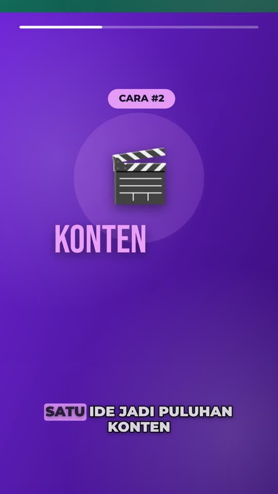

# KanvasCut — editor video HTML Canvas + AI

Editor video mirip CapCut yang berjalan 100% di browser: preview dan render memakai
**HTML Canvas**, ekspor memakai **WebCodecs → MP4 H.264** (tanpa server, tanpa biaya render), dan
fitur AI memakai **Claude API** langsung dari browser.

## Contoh hasil

[`examples/bisnis-ai.mp4`](examples/bisnis-ai.mp4) — video 9:16, 26 detik, tema "Bisnis dengan AI",
dirender oleh editor ini dari template bawaan (tab **Template**). Musik latar disintesis sendiri
(`examples/assets/musik-bisnis.mp3`), jadi bebas hak cipta.



## Menjalankan

Tidak perlu build. Cukup sajikan foldernya lewat HTTP (ES module tidak jalan dari `file://`):

```bash
python3 -m http.server 8000
# buka http://localhost:8000
```

Bisa juga di-host gratis di GitHub Pages / Netlify / Vercel sebagai situs statis.

## Fitur

- Impor video, gambar, audio (klik atau drag & drop)
- Timeline multi-track: geser klip, trim ujung kiri/kanan, snap ke playhead & tepi klip, zoom
- Potong (S), duplikat (Ctrl+D), hapus (Del), undo/redo (Ctrl+Z / Ctrl+Shift+Z)
- Teks dengan preset (judul, subtitle, caption kotak, neon, lower third), font, warna,
  garis tepi, glow, latar, animasi (pop, fade, slide, mesin ketik)
- Transformasi langsung di preview (geser, scroll untuk skala), rotasi, opasitas, fade in/out
- Filter: kecerahan, kontras, saturasi, grayscale, hue, blur
- Kecepatan klip 0.25x–4x, volume, mute
- Rasio 9:16, 16:9, 1:1, 4:5
- **Transisi** antar klip: crossfade, geser, zoom, whip (blur cepat), wipe, lingkaran
- **Keyframe** posisi/skala/rotasi/opasitas dengan easing (tombol ◆ atau tombol K); geser objek di
  playhead otomatis membuat keyframe
- **Gerak kamera (Ken Burns)**: zoom in/out dan pan pelan untuk foto & video
- **Subtitle karaoke** (kata aktif disorot, dengan kotak warna) dan mode **kata per kata**
- **Elemen grafis**: latar gradien bergerak, kotak, lingkaran, progress bar
- **Font** Montserrat, Bebas Neue, Poppins (disertakan di `fonts/`, jalan offline)
- **Template** siap pakai: "Bisnis dengan AI"
- **Ekspor MP4 H.264 via WebCodecs**: frame dirender satu per satu (tanpa frame drop), audio
  dicampur offline (AAC di Chrome/Edge/Safari, Opus bila AAC tidak ada). Browser tanpa WebCodecs
  otomatis memakai perekaman real-time (MediaRecorder).

### Fitur AI (Claude)

Isi API key di tab **AI ✨** (key hanya disimpan di localStorage browser dan dikirim ke
`api.anthropic.com`). Pilih model: Opus 5.5 (paling pintar), Sonnet 5.5, atau Haiku 5.5 (paling murah).

1. **Buat video otomatis dari ide** — Claude menyusun adegan (label, emoji, judul, isi, subtitle,
   warna latar, transisi) dan editor membangunnya dengan tata letak motion graphics yang sama seperti
   template. Video/gambar milikmu tetap dipakai sebagai latar. Opsional: kirim frame preview.
2. **Subtitle dari naskah** — tempel naskah, Claude memecahnya jadi subtitle berwaktu.
3. **Perintah edit (AI agent)** — perintah bahasa biasa, mis. "semua teks kuning dengan animasi
   pop, potong klip pertama di detik 3". Claude membaca status proyek lalu mengembalikan daftar
   operasi (update / delete / split / add_text / set_background) yang diterapkan editor. Bisa di-undo.

Semua jawaban AI memakai *structured outputs* (JSON schema), jadi hasilnya selalu bisa dibaca
editor. SDK `@anthropic-ai/sdk` dimuat dari CDN hanya saat fitur AI dipakai.

> Catatan keamanan: memanggil API dari browser hanya aman untuk key milik sendiri. Kalau aplikasi
> ini mau dipakai orang lain, pindahkan panggilan AI ke backend kecil (mis. Cloudflare Worker)
> supaya key tidak terekspos.

## Struktur

```
index.html          tata letak UI
css/style.css       tema gelap + @font-face
js/app.js           state proyek, timeline, inspector, interaksi, AI, template
js/render.js        mesin render kanvas (dipakai preview & ekspor): transisi, keyframe, teks, bentuk
js/export.js        ekspor WebCodecs + pencampur audio offline
js/templates.js     pembuat adegan + template "Bisnis dengan AI"
js/ai.js            klien Claude + skema JSON untuk tiap fitur AI
js/vendor/          mp4-muxer 5.2.2 (MIT)
fonts/              Montserrat, Bebas Neue, Poppins (SIL OFL)
examples/           video contoh + musik
```

## Batasan & ide lanjutan

- Kecepatan ekspor tergantung perangkat (encoder hardware di Chrome biasanya lebih cepat dari real-time).
- Proyek belum disimpan otomatis (media tersimpan sebagai blob sementara).
- Integrasi AI lain bisa ditambahkan di `js/ai.js`: text-to-speech untuk voice-over,
  generator gambar/B-roll, atau transkripsi audio untuk subtitle otomatis.
